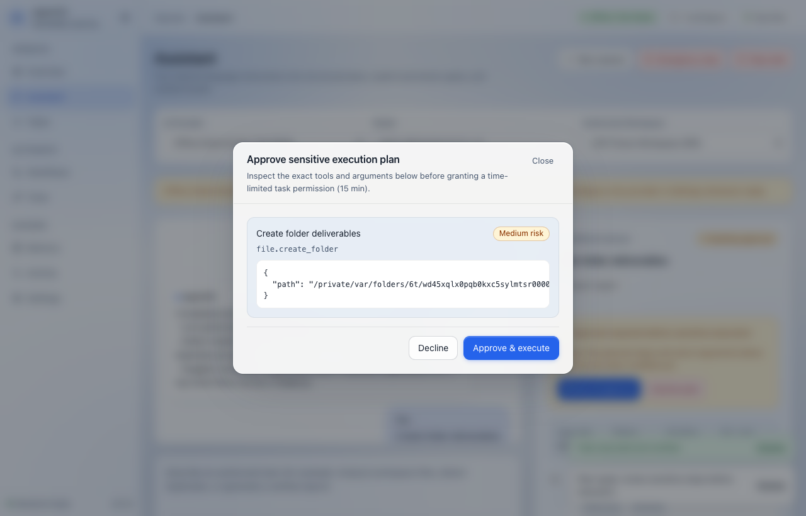
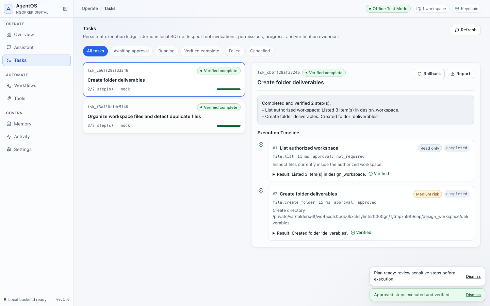
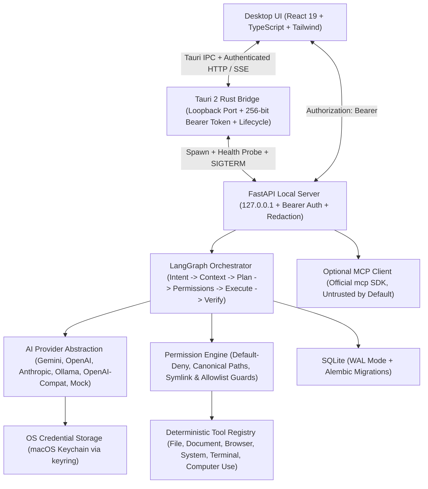

# AgentOS

**Intelligence that takes action.**

A local-first, open-source autonomous AI desktop agent that turns natural-language instructions into controlled, observable, and verifiable computer actions.

- Organization: **NGOPREK DIGITAL**
- Author: **Dandi Setiawan**
- License: **Apache License 2.0**

---

## Overview

AgentOS connects natural-language reasoning to deterministic local tools inside explicit human-controlled permission boundaries. Every request passes through structured intent analysis, task planning, risk classification, permission enforcement, execution previews, deterministic verification, and secret-redacted audit logging.

AgentOS runs locally without requiring a paid subscription to open or evaluate. Users bring their own API keys (stored in OS Keychain) or connect local models through Ollama or an OpenAI-compatible server. An explicitly labeled Offline Deterministic Test Mode is included for automated tests and offline walkthroughs.

## Implemented Capabilities

- **Desktop Application (Tauri 2 + Rust + React + TypeScript + Tailwind CSS)**: Native macOS WKWebView shell with strict Content Security Policy, least-privilege capabilities, Light/Dark/System themes, keyboard navigation, and 8 functional operational views (Overview, Assistant, Tasks, Workflows, Tools, Memory, Activity, Settings).
- **Authenticated Local Backend Lifecycle**: Rust desktop bridge selects a free `127.0.0.1` loopback port, generates a 256-bit random session token passed over `Authorization: Bearer` headers, probes `/api/v1/health`, and shuts down the Python backend cleanly with `SIGTERM` on exit.
- **Provider-Independent AI Abstraction**: Adapters for Google Gemini API, OpenAI API, Anthropic API, Ollama local models, OpenAI-compatible endpoints, and Offline Deterministic Test Mode, with model discovery, connection testing, timeouts, bounded exponential backoff, context-window trimming, token tracking, and cost estimation where published pricing exists.
- **LangGraph Agent Core & 10-State Persistence**: Typed states (`created`, `planning`, `awaiting_approval`, `approved`, `running`, `paused`, `verifying`, `completed`, `failed`, `cancelled`) persisted in SQLite (WAL mode + Alembic migrations), per-task execution budgets, duplicate side-effect prevention, safe recovery for transient non-mutating failures, cancellation, rollback, and mandatory result verification.
- **24 Strongly Typed Built-in Tools**:
  - **File Intelligence**: list, search, read, metadata/SHA-256, duplicate detection, folder organization proposals, create folder, rename, move, copy, and rollback restoration.
  - **Document Intelligence**: read PDF, DOCX, TXT, Markdown, CSV, XLSX; compare documents; generate Markdown, PDF, DOCX, CSV, and XLSX reports with reopen-parse verification.
  - **Browser Intelligence**: isolated Playwright contexts for webpage extraction, bounded screenshots, approved form filling, and Markdown/JSON export (never bypasses CAPTCHA or authentication).
  - **System Intelligence**: read-only OS/CPU/RAM/disk diagnostics, running processes, large workspace file discovery, and approved macOS application launching.
  - **Terminal Intelligence**: disabled by default; structured `exec` argument lists without shell interpolation, command allowlist, permanent destructive blocklist, working-directory bounds, output caps, timeouts, and sanitized environment variables.
  - **Computer Use (macOS Intel Verified)**: capability detection for macOS Accessibility and Screen Recording permissions, visible non-sensitive window inspection, separately authorized single-frame screenshots, and a global Emergency Stop control.
- **Local Memory, Workflows, and MCP**: Searchable SQLite memory with retention policies, export, and disable toggle; built-in and custom workflows with manual run and in-app interval scheduling (active while AgentOS is open); optional Model Context Protocol integration via the official Python `mcp` SDK with default-untrusted explicit tool allowlisting.

## Real Application Screenshots

Captured from the live running production bundle paired with the local FastAPI backend during automated Playwright end-to-end verification:

### Overview (Light Theme)


### Explicit Permission Approval Gate (Native Modal Dialog)


### Assistant Plan, Verification & Rollback (Dark Theme)


### Persistent Task Timeline Inspector


### AI Providers & Keychain Settings


## Architecture



## System Requirements

- **Primary Verified Machine**: MacBook Pro 2019, Intel Core i5-8279U (`x86_64`), 8 GB RAM, macOS 15.8.3
- **Development Toolchains**:
  - Node.js `>= 22.0.0` and `pnpm >= 10.0.0`
  - Python `3.12` (managed cleanly via `uv`)
  - Rust stable (`rustc`, `cargo`, `rustfmt`, `clippy`) for Tauri 2
  - Playwright Chromium browser binary for Browser Intelligence tools

No dedicated GPU, CUDA, or Apple Silicon hardware is required.

## Installation

```bash
# 1. Clone the repository
git clone https://github.com/dandisetiawan-co/agentos.git
cd agentos

# 2. Install frontend monorepo dependencies
pnpm install

# 3. Install isolated Python 3.12 backend dependencies
uv sync --directory backend --python 3.12

# 4. Install Playwright Chromium if not already cached
cd backend && uv run playwright install chromium && cd ..
```

## Quick Start

### Run in Desktop Development Mode (Tauri 2 + Local Backend)

Ensure `~/.cargo/bin` is on your `PATH`, then launch Tauri:

```bash
export PATH="$HOME/.cargo/bin:$PATH"
pnpm dev:tauri
```

The Rust bridge automatically selects a free localhost port, generates an ephemeral session token, boots `backend/.venv/bin/python -m agentos`, waits for `/api/v1/health`, and shuts the backend down cleanly when you close the window.

### Run Backend and Frontend Separately (Browser Dev Mode)

```bash
# Terminal 1: start authenticated local backend
export AGENTOS_SESSION_TOKEN="dev-local-token-change-me"
pnpm backend:dev

# Terminal 2: start Vite dev server
VITE_AGENTOS_API_URL="http://127.0.0.1:47821" \
VITE_AGENTOS_SESSION_TOKEN="dev-local-token-change-me" \
pnpm dev:desktop
```

## Supported AI Providers

| Provider | Credentials | Local / Cloud | Model Discovery |
| --- | --- | --- | --- |
| Google Gemini API | User API key (OS Keychain) | Cloud | Live `/models` + curated defaults |
| OpenAI API | User API key (OS Keychain) | Cloud | Live `/models` + curated defaults |
| Anthropic API | User API key (OS Keychain) | Cloud | Live `/models` + curated defaults |
| Ollama | None required | Local (`127.0.0.1:11434`) | Live `/api/tags` |
| OpenAI-Compatible | Optional key (OS Keychain) | Local or self-hosted | Live `/models` |
| Offline Deterministic Test Mode | None required | Local (zero network) | Deterministic planner (`mock-deterministic-v1`) |

## Configuration

Copy `.env.example` only for headless CLI testing. Desktop users configure providers, API keys, workspaces, execution budgets, memory retention, terminal allowlists, MCP servers, and appearance inside **Settings**.

Data directory defaults to `~/Library/Application Support/AgentOS` on macOS (override with `AGENTOS_DATA_DIR`).

## Usage Examples

1. **Authorize a workspace**: Open **Settings -> Authorized Workspaces**, select a folder (system and credential folders such as `/etc`, `/System`, and `~/.ssh` are permanently rejected), and click **Authorize**.
2. **Audit workspace duplicates**: Open **Assistant**, pick your authorized workspace, and run: `Organize workspace files and detect duplicate files`. Read-only tools execute and verify automatically.
3. **Mutate with preview and rollback**: Run `Create folder deliverables`. AgentOS pauses in `awaiting_approval`, displays the exact tool and canonical path inside a native modal dialog, executes only after explicit approval, verifies the directory on disk, and offers one-click **Restore files**.
4. **Generate verified reports**: Run `Generate a Markdown report for metrics.csv` to write and reopen-validate the generated document.

## Security & Privacy Model

- **Local-first by default**: All SQLite task records, audit logs, and memory entries remain on your machine.
- **OS Keychain secrets**: Raw API keys are stored via `keyring` (macOS Keychain) and scrubbed from logs, error responses, and diagnostic exports by `SecretRedactor`.
- **Execution-boundary enforcement**: Untrusted content from files, webpages, or command output can never modify permissions, bypass allowlists, or trigger unapproved mutations.
- **No false claims**: No software is impossible to compromise. See [SECURITY.md](SECURITY.md) and [docs/security/THREAT_MODEL.md](docs/security/THREAT_MODEL.md) for boundaries and MCP risks.

## Testing

```bash
# Backend static checks + full unit, integration, security, and Playwright E2E suites
cd backend
uv run ruff check agentos tests
uv run ruff format --check agentos tests
uv run mypy agentos
uv run pytest -c pyproject.toml tests ../tests/integration ../tests/security ../tests/e2e -v
uv run pip-audit --desc=off

# Frontend strict typecheck, ESLint, Vitest, and Vite production build
pnpm typecheck && pnpm lint && pnpm test && pnpm build

# Rust desktop bridge formatting, Clippy, and unit tests
cargo fmt --manifest-path apps/desktop/src-tauri/Cargo.toml -- --check
cargo clippy --manifest-path apps/desktop/src-tauri/Cargo.toml -- -D warnings
cargo test --manifest-path apps/desktop/src-tauri/Cargo.toml
```

## Measured Benchmarks & AI Quality Evaluations

All measurements below were actually executed on **MacBook Pro 2019, Intel Core i5-8279U (`x86_64`), 8 GB RAM, macOS 15.8.3, Python 3.12.16**.

### Performance Benchmarks (`benchmarks/perf_benchmark.py`)

| Measurement | Actual Result |
| --- | --- |
| Backend cold startup (subprocess to `/api/v1/health` 200 OK) | `4039.6 ms` |
| Backend idle RSS memory | `145.86 MB` |
| End-to-end HTTP task overhead (plan + execute + verify) | `315.0 ms` |
| `file.list` (40 workspace files) | `11.66 ms` |
| `file.duplicates` (40 files SHA-256) | `149.18 ms` |
| `system.health` (OS/CPU/RAM/disk) | `151.77 ms` |
| PDF generate + reopen parse | `19.69 ms` |
| DOCX generate + reopen parse | `108.61 ms` |
| XLSX generate + reopen parse | `42.09 ms` |
| SQLite indexed read average (100 queries) | `2.095 ms` |

### AI Evaluation Suite (`benchmarks/ai_eval.py`, Offline Deterministic Mode, 8 Scenarios)

| Metric | Measured Score |
| --- | --- |
| Intent recognition accuracy | `100%` (8/8) |
| Correct tool selection rate | `100%` (8/8) |
| Plan validity rate | `100%` (8/8) |
| Task completion rate (allowed scenarios) | `100%` (6/6) |
| Verification accuracy | `100%` (6/6) |
| Unauthorized action rejection rate | `100%` (2/2) |
| Transient failure recovery rate | `100%` (1/1) |
| Average tool calls / tokens / latency | `1.62` calls / `1834.8` tokens / `404.6 ms` |

*Note: Offline evaluation validates deterministic orchestration, permission enforcement, tool accuracy, and verification without external API variability. Live external provider evaluations depend on user-supplied API credentials and remote model behavior.*

## Known Limitations

- **Runtime verification scope**: Verified natively on **macOS Intel (`x86_64`, macOS 15.8.3)**. Apple Silicon (`arm64`), Windows, and Linux build configurations are included in CI, but runtime behavior on those platforms has not been tested on physical hardware yet.
- **Bundled Python runtime**: The initial `v0.1.0` macOS `.app` bundle expects the local repository `.venv` or an `AGENTOS_BACKEND_BIN` sidecar binary. Standalone bundled Python packaging for zero-setup end-user installers is scheduled for `v0.2.0`.
- **Workflow scheduling**: Scheduled workflows execute while AgentOS is running. Closed-app background scheduling (`launchd`) is not enabled in `v0.1.0`.
- **macOS signing & notarization**: Local production builds are unsigned; public macOS distribution requires Apple Developer ID signing and notarization (`APPLE_SIGNING_IDENTITY`, `APPLE_ID`, `APPLE_PASSWORD`, `APPLE_TEAM_ID`).

## Roadmap & Contributing

- Roadmap: [ROADMAP.md](ROADMAP.md)
- Changelog: [CHANGELOG.md](CHANGELOG.md)
- Contributing: [CONTRIBUTING.md](CONTRIBUTING.md)
- Code of Conduct: [CODE_OF_CONDUCT.md](CODE_OF_CONDUCT.md)
- Third-Party Notices: [THIRD_PARTY_NOTICES.md](THIRD_PARTY_NOTICES.md)

## License & Attribution

Copyright 2026 **NGOPREK DIGITAL** (**Dandi Setiawan**).
Licensed under the [Apache License, Version 2.0](LICENSE).
