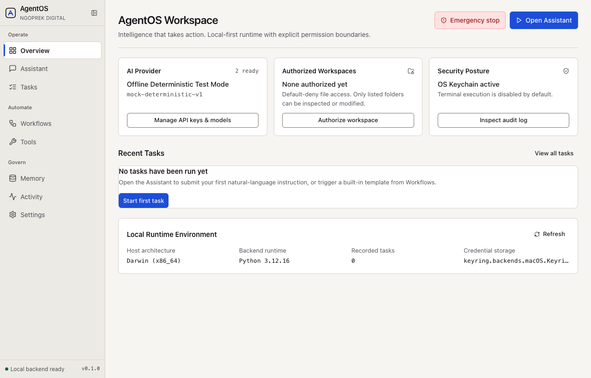
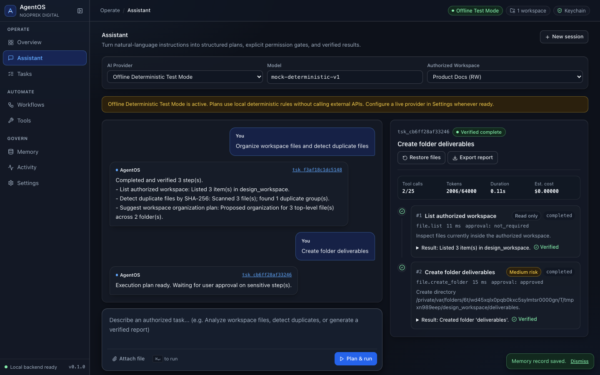
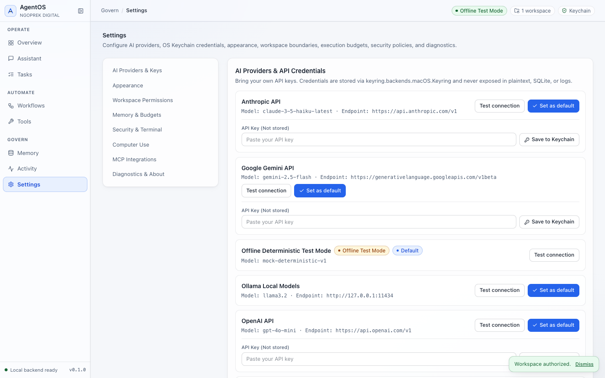
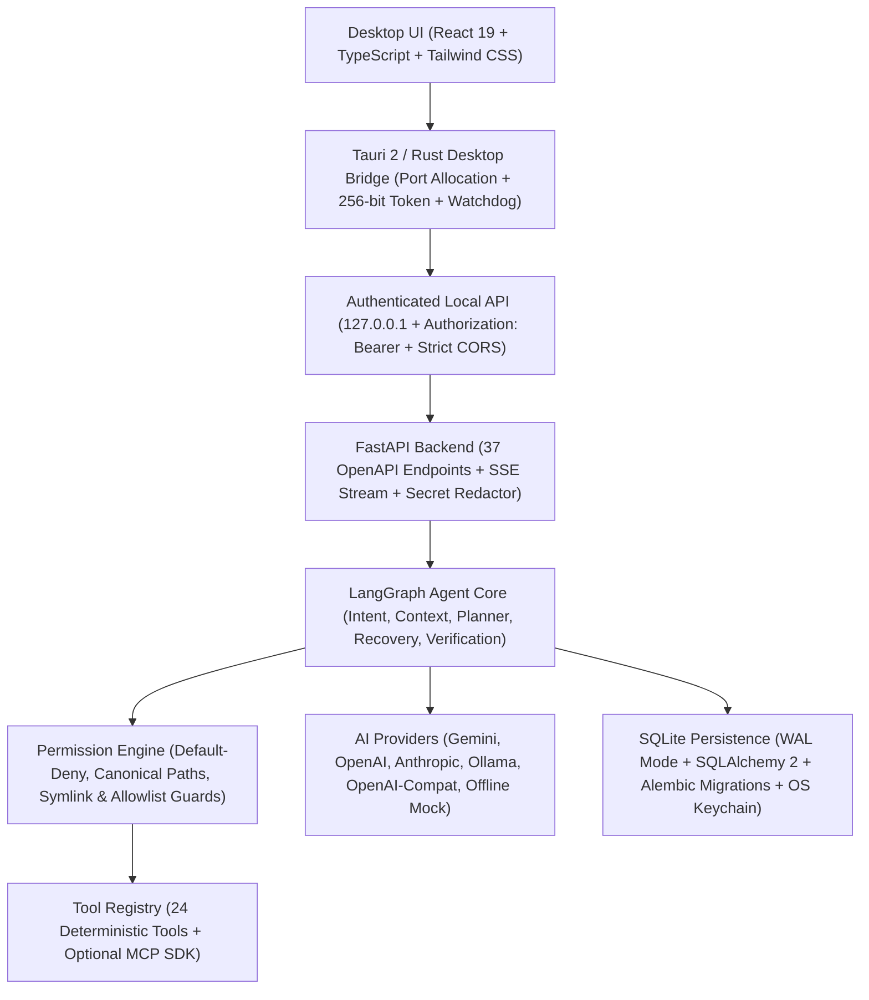

# AgentOS

**Intelligence that takes action.**

A local-first, open-source AI desktop assistant that plans, executes, and verifies authorized computer tasks.

[](LICENSE)
[](https://github.com/dandisetiawanco/AgentOs/actions/workflows/ci.yml)
[](CHANGELOG.md)
[](backend/pyproject.toml)
[](apps/desktop/src-tauri/Cargo.toml)
[](apps/desktop/src-tauri/tauri.conf.json)

---

## Project Overview

Ordinary AI chatbots generate text and leave every manual step to the user. Autonomous scripting tools can execute actions, yet often lack structured permissions, previews, audit trails, or verification.

**AgentOS** bridges that gap locally on your machine:

1. **Intent & Planning**: Converts natural-language instructions into structured, typed execution plans using LangGraph.
2. **Default-Deny Permissions**: Classifies risk (`READ_ONLY`, `LOW`, `MEDIUM`, `HIGH`, `BLOCKED`) and enforces canonical workspace boundaries deterministically in Python before any tool runs.
3. **Human-in-the-Loop Approval**: Pauses mutating or sensitive actions in `awaiting_approval`, shows the exact tool and arguments in a native modal preview, and runs only after explicit user consent.
4. **Deterministic Verification & Rollback**: Verifies actual filesystem and document outcomes after execution, records step-level audit logs in local SQLite, and supports one-click file rollback for recorded operations.

**Intended users**: Developers, technical operators, researchers, and privacy-conscious desktop users who want observable local AI automation with explicit human oversight and bring-your-own AI credentials.

## Features

### Implemented in v0.1.0
- **Desktop Application (`apps/desktop`)**: Tauri 2 + Rust desktop bridge and React 19 + TypeScript (strict) + Tailwind CSS 4 interface with 8 operational views (Overview, Assistant, Tasks, Workflows, Tools, Memory, Activity, Settings) and Light, Dark, and System themes.
- **Authenticated Local Backend (`backend/agentos`)**: FastAPI server bound strictly to `127.0.0.1` on an ephemeral port with a 256-bit `getrandom` bearer session token, OS Keychain credential storage (`keyring`), secret redaction, SQLite WAL persistence with Alembic migrations, and parent-PID orphan prevention.
- **Multi-Provider AI Abstraction**: Google Gemini API, OpenAI API, Anthropic API, Ollama local models, custom OpenAI-compatible endpoints, and an explicitly labeled Offline Deterministic Test Mode (`mock-deterministic-v1`). Includes model discovery, connection checks, bounded retries, timeouts, context trimming, and token/cost tracking where published pricing exists.
- **LangGraph Agent Orchestration**: Typed 10-state machine (`created`, `planning`, `awaiting_approval`, `approved`, `running`, `paused`, `verifying`, `completed`, `failed`, `cancelled`), per-task execution budgets, duplicate side-effect prevention, transient read-only recovery, cancellation, and verification.
- **File Intelligence (10 tools)**: Authorized directory listing, search, file reading, metadata/SHA-256 hashing, duplicate detection, folder organization proposals, folder creation, rename, move, copy, change preview, and rollback restoration.
- **Document Intelligence (3 tools)**: Read PDF, DOCX, TXT, Markdown, CSV, and XLSX; compare documents; generate Markdown, PDF, DOCX, CSV, and XLSX reports with reopen-parse validation.
- **Browser Intelligence (4 tools)**: Isolated Playwright Chromium contexts for public webpage extraction, bounded screenshots, approved form filling, and Markdown/JSON export with SSRF/private-IP guards.
- **System Diagnostics (4 tools)**: Read-only OS/CPU/RAM/disk health inspection, running process summary, large workspace file scan, and explicitly approved macOS application launching.
- **Persistent Task History, Memory & Workflows**: SQLite task timelines, searchable local memory with retention controls and export, and reusable workflow templates with manual runs and in-app interval scheduling (active while AgentOS is open).

### Experimental / Opt-In Capabilities (Disabled by Default)
- **Restricted Terminal Tool (`terminal.run`)**: Disabled until explicitly enabled in Settings. Uses `create_subprocess_exec` with structured argument arrays (no shell interpolation), command allowlists, permanent destructive blocklists, cwd bounds, output limits, timeouts, and sanitized environments.
- **MCP Integration**: Official Python `mcp` SDK stdio server registry in Settings. External MCP servers are untrusted by default, run with stripped environment variables, and require explicit per-tool allowlisting.
- **macOS Computer Use (`desktop.observe`, `desktop.act`)**: Disabled by default. Detects macOS Accessibility and Screen Recording permissions, inspects non-sensitive visible windows, supports separately authorized single-frame screenshots, and provides a global Emergency Stop switch.

### Planned Roadmap Items
- Standalone bundled Python sidecar installers (`.dmg`, Windows MSI, Linux AppImage) that require no local Python or `uv` installation (`v0.2.0`).
- Physical hardware runtime verification on Apple Silicon (`arm64`), Windows 11, and Ubuntu Linux, plus Apple Developer ID code signing and notarization (`v0.2.0`).
- Live token streaming in the Assistant view for remote LLM providers (`v0.2.0`).
- Optional OS-level background scheduling (`launchd`) with explicit opt-in (`v0.3.0`).

See [ROADMAP.md](ROADMAP.md) for the full release plan.

## Screenshots

Captured from the production Vite desktop bundle connected to the live local FastAPI backend during automated Playwright end-to-end verification ([tests/e2e/test_full_e2e.py](tests/e2e/test_full_e2e.py)):

| Overview (Light Theme) | Explicit Permission Approval Gate |
| --- | --- |
|  |  |

| Assistant Plan, Verification & Rollback (Dark Theme) | Persistent Task Timeline Inspector |
| --- | --- |
|  |  |

| AI Providers & Keychain Settings |
| --- |
|  |

## Architecture



Detailed architecture and threat documentation: [docs/architecture/OVERVIEW.md](docs/architecture/OVERVIEW.md), [docs/ARCHITECTURE_DECISIONS.md](docs/ARCHITECTURE_DECISIONS.md), and [docs/api/openapi.json](docs/api/openapi.json).

## Installation

### Prerequisites
- **Node.js**: `>= 22.0.0`
- **pnpm**: `12.x` (managed via `packageManager` field or `corepack enable`)
- **Python**: `3.12` (recommended via [`uv`](https://docs.astral.sh/uv/))
- **Rust**: Stable toolchain (`rustc`, `cargo`, `rustfmt`, `clippy`) for Tauri 2
- **Platform dependencies**:
  - **macOS**: Xcode Command Line Tools (`xcode-select --install`)
  - **Linux (Ubuntu/Debian, build verification)**: `libwebkit2gtk-4.1-dev build-essential curl wget file libxdo-dev libssl-dev libayatana-appindicator3-dev librsvg2-dev patchelf`
  - **Windows (build verification)**: Microsoft C++ Build Tools and WebView2 Runtime

No dedicated GPU, CUDA, or Apple Silicon hardware is required.

### Source Installation

```bash
# 1. Clone the repository
git clone https://github.com/dandisetiawanco/AgentOs.git
cd AgentOs

# 2. Install frontend monorepo dependencies
pnpm install --frozen-lockfile

# 3. Install isolated Python 3.12 backend dependencies
uv sync --directory backend --python 3.12 --frozen

# 4. Install Playwright Chromium for Browser Intelligence tools (if not cached)
cd backend && uv run playwright install chromium && cd ..
```

### Running Locally

**Desktop Mode (Tauri 2 + Automatic Local Backend):**

```bash
export PATH="$HOME/.cargo/bin:$PATH"
pnpm dev:tauri
```

The Rust desktop bridge allocates a free localhost port, creates a 256-bit random session token, spawns `backend/.venv/bin/python -m agentos`, waits for `/api/v1/health`, and terminates the backend cleanly on exit.

**Browser Dev Mode (Separate Backend + Vite Dev Server):**

```bash
# Terminal 1: Start local authenticated backend
export AGENTOS_SESSION_TOKEN="dev-local-token-change-me"
pnpm backend:dev

# Terminal 2: Start Vite frontend
VITE_AGENTOS_API_URL="http://127.0.0.1:47821" \
VITE_AGENTOS_SESSION_TOKEN="dev-local-token-change-me" \
pnpm dev:desktop
```

## Configuration

AgentOS follows a **Bring Your Own API Key (BYOK)** model. No developer API keys are bundled, and opening the application never requires a paid account.

| Provider | Credentials | Endpoint / Mode | Model Discovery |
| --- | --- | --- | --- |
| **Google Gemini API** | User API key (OS Keychain) | Cloud | Live `/models` + defaults |
| **OpenAI API** | User API key (OS Keychain) | Cloud | Live `/models` + defaults |
| **Anthropic API** | User API key (OS Keychain) | Cloud | Live `/models` + defaults |
| **Ollama** | None required | Local (`http://127.0.0.1:11434`) | Live `/api/tags` |
| **OpenAI-Compatible** | Optional key (OS Keychain) | Custom base URL | Live `/models` |
| **Offline Deterministic Test Mode** | None required | Local (zero network) | `mock-deterministic-v1` |

> **Important note on Google Gemini**: Consumer Gemini subscriptions (such as Gemini Advanced / Google AI Pro) do not automatically grant Gemini API credits or API keys. API usage requires an API key created in Google AI Studio or Google Cloud with appropriate API quota/billing enabled.

All desktop settings (providers, workspaces, budgets, memory retention, terminal allowlists, MCP servers, appearance) are configured inside **Settings**. Application data is stored locally under `~/Library/Application Support/AgentOS` on macOS (override with `AGENTOS_DATA_DIR`). See [.env.example](.env.example) for CLI/development environment variables and [docs/user-guide/USER_GUIDE.md](docs/user-guide/USER_GUIDE.md) for walkthroughs.

## Security

- **Local-First Operation**: SQLite task state, memory records, and audit logs remain strictly on the local host.
- **Workspace Authorization**: File and document tools are default-deny and only access explicitly authorized directories. System paths (`/System`, `/etc`, `/usr`, `/Library`, `/`, home root), credential paths (`~/.ssh`, `~/.aws`, `~/Library/Keychains`, `.env`), directory traversal (`../`), and escaping symlinks are blocked.
- **Execution-Boundary Prompt Injection Defense**: Untrusted external content from files, webpages, or command output is isolated as data and cannot alter permissions, bypass allowlists, or skip approval gates.
- **Credential Storage**: Raw API keys are saved in macOS Keychain via `keyring` and scrubbed from logs, error messages, and diagnostic exports by `SecretRedactor`.
- **User Approval & Emergency Stop**: Every mutating or high-risk step pauses for native modal confirmation; an Emergency Stop control halts active tasks and blocks non-read-only tools immediately.
- **Restricted Tools**: Terminal execution, Computer Use, and external MCP servers are disabled or untrusted by default.

See [SECURITY.md](SECURITY.md) and [docs/security/THREAT_MODEL.md](docs/security/THREAT_MODEL.md) for the complete threat model and vulnerability reporting process.

## Testing

```bash
# Python lint, formatting, static typecheck, and vulnerability scan
cd backend
uv run ruff check agentos tests ../tests ../benchmarks ../scripts
uv run ruff format --check agentos tests ../tests ../benchmarks ../scripts
uv run mypy agentos
uv run pip-audit --desc=off

# Python unit and security suites (18 tests)
uv run pytest -c pyproject.toml tests ../tests/security -v

# Integration and full-stack Playwright E2E suites (3 tests, requires `pnpm build` first)
uv run pytest -c pyproject.toml ../tests/integration ../tests/e2e -v
cd ..

# Frontend formatting, typecheck, ESLint, Vitest, and production build
pnpm format:check && pnpm typecheck && pnpm lint && pnpm test && pnpm build

# Rust desktop bridge formatting, Clippy, and unit tests (3 tests)
cargo fmt --manifest-path apps/desktop/src-tauri/Cargo.toml -- --check
cargo clippy --manifest-path apps/desktop/src-tauri/Cargo.toml -- -D warnings
cargo test --manifest-path apps/desktop/src-tauri/Cargo.toml
```

### Measured Local Benchmarks (macOS 15.8.3 Intel `x86_64`, 8 GB RAM)

Recorded via `benchmarks/perf_benchmark.py` and `benchmarks/ai_eval.py` on MacBook Pro 2019 (Intel Core i5-8279U, Python 3.12.16):
- **Backend cold startup**: `4039.6 ms` | **Idle RSS memory**: `145.86 MB` | **HTTP task overhead**: `315.0 ms`
- **`file.list` (40 files)**: `11.66 ms` | **`file.duplicates` SHA-256 (40 files)**: `149.18 ms` | **SQLite avg query (100 reads)**: `2.095 ms`
- **Document generate + reopen parse**: PDF `19.69 ms`, XLSX `42.09 ms`, DOCX `108.61 ms`
- **Offline Deterministic AI Eval (8 scenarios)**: 8/8 intent, tool selection, and plan validity; 6/6 completion and verification; 2/2 unauthorized blocking; 1/1 transient recovery (see [benchmarks/results/EVAL_REPORT.md](benchmarks/results/EVAL_REPORT.md)).

## Supported Platforms

| Platform | Verification Status | Notes |
| --- | --- | --- |
| **macOS 15.8.3 Intel (`x86_64`)** | **Native Runtime Verified** | Full unit, security, integration, Playwright E2E, `tauri build`, and live `AgentOS.app` startup/shutdown verified on physical Intel MacBook Pro. |
| **macOS Apple Silicon (`arm64`)** | **CI Build Configured** | Configured in `.github/workflows/ci.yml`; runtime behavior not yet verified on physical `arm64` hardware. |
| **Windows 11 (`x86_64`)** | **CI Build Configured** | Compilation configured in CI (`--no-bundle`); Windows runtime behavior is untested. |
| **Linux (`x86_64`, Ubuntu)** | **CI Build Configured** | Compilation configured in CI (`--no-bundle`); Linux runtime behavior is untested. |

## Known Limitations

- **Source-coupled backend runtime in `v0.1.0`**: The built macOS `AgentOS.app` locates `backend/.venv` inside the repository checkout (or an explicit `AGENTOS_BACKEND_BIN`). It is **not** a standalone zero-dependency end-user installer yet; install from source until standalone sidecar bundling ships in `v0.2.0`.
- **Unsigned macOS bundles**: Local macOS builds are ad-hoc signed only; Apple Developer ID signing and notarization are not configured yet.
- **Cross-platform runtime coverage**: Only macOS Intel (`x86_64`) has been runtime-tested on real hardware.
- **In-app workflow scheduler**: Scheduled workflows execute while AgentOS is open; OS-level background scheduling (`launchd`) is planned for `v0.3.0`.
- **Offline eval scope**: Published AI evaluation scores measure deterministic local orchestration (`mock-deterministic-v1`); remote LLM accuracy depends on the model and provider configured by the user.

## Contributing & Documentation

- Contributing Guidelines: [CONTRIBUTING.md](CONTRIBUTING.md)
- Developer Guide: [docs/development/DEVELOPMENT.md](docs/development/DEVELOPMENT.md)
- User Guide: [docs/user-guide/USER_GUIDE.md](docs/user-guide/USER_GUIDE.md)
- Validation Report: [docs/VALIDATION_REPORT.md](docs/VALIDATION_REPORT.md)
- Code of Conduct: [CODE_OF_CONDUCT.md](CODE_OF_CONDUCT.md)
- Changelog: [CHANGELOG.md](CHANGELOG.md)
- Third-Party Notices: [THIRD_PARTY_NOTICES.md](THIRD_PARTY_NOTICES.md)

## License

AgentOS is licensed under the [Apache License 2.0](LICENSE).

## Author

- **Author**: Dandi Setiawan
- **Organization**: NGOPREK DIGITAL
- **Website**: https://www.ngoprekdigital.site/
